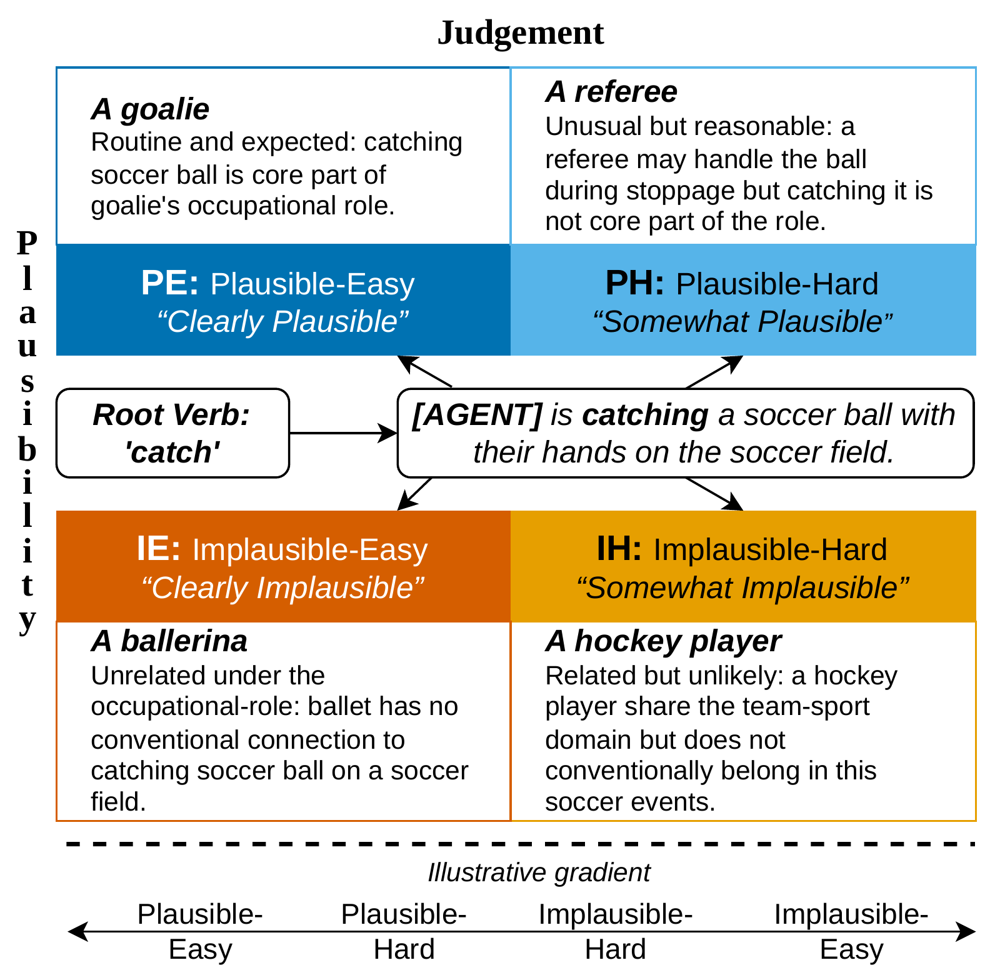
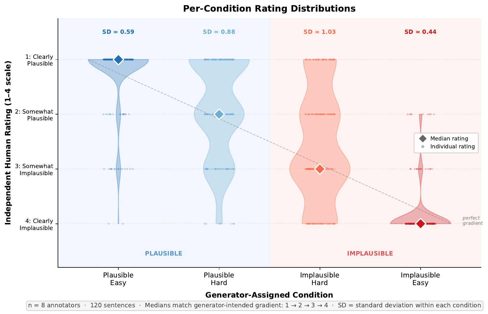

<h1 align="center">STRIVE</h1>

<p align="center"><strong>Probing Reasoning Limits in Graded Plausibility Generation and Evaluation</strong></p>

<p align="center">
  Bhiman Kumar Baghel · Anna Chrabaszcz · Tessa Warren · Michael Walsh Dickey · Haley C. Dresang · Xiang Lorraine Li
</p>

<p align="center">
  
  <a href="https://arxiv.org/abs/2608.04567"></a>
  <a href="#quick-start"></a>
  <a href="LICENSE"></a>
</p>

<p align="center">
  <a href="https://arxiv.org/pdf/2608.04567">Paper PDF</a> ·
  <a href="#quick-start">Quick start</a> ·
  <a href="#reproduce-the-paper">Reproduce the paper</a> ·
  <a href="#run-new-experiments">Run new experiments</a> ·
  <a href="#citation">Citation</a>
</p>

STRIVE generates controlled sets of four sentences for studying event plausibility.
Given a verb, STRIVE builds a shared event frame, varies one role such as the
agent, and targets four conditions: **plausible–easy (PE)**, **plausible–hard
(PH)**, **implausible–hard (IH)**, and **implausible–easy (IE)**. A model evaluator
scores the sentences and can guide refinement.

<p align="center">
  
  <br>
  <em><a href="https://arxiv.org/html/2608.04567v1#S0.F1">Figure 1 from the paper</a></em>
</p>

## Quick start

Install the experiment environment with `uv` and Python 3.12 or newer.

```bash
git clone https://github.com/bhimanbaghel/STRIVE-EACL.git
cd STRIVE-EACL
uv sync --locked
```

Start with the bundled results to reproduce the paper’s analyses on a CPU.
For generation or fresh evaluation, see [Run new experiments](#run-new-experiments).

## Reproduce the paper

The paper evaluates six generators on 60 verbs. For GPT-5.1, the share of
high-quality (GOLD) sets rises from **28.3%** with the single-shot reasoning
base (RB) to **75.0%** with evaluator-guided refinement (R2R). In the human
study, eight annotators rated 120 sentences. Their ratings varied most for
the implausible–hard condition.

<p align="center">
  
</p>

### Verify the reported results

From the repository root, run:

```bash
uv run --locked python analysis/generate_model_method_gold_table.py --check
uv run --locked python analysis/generate_token_comparison.py
```

The first command checks the published GPT-5.1 and Qwen3-30B-Thinking GOLD
rates. The second rebuilds the [token-cost report](results/aggregate/generation_token_comparison.md)
from bundled per-verb counts.

### Reproduce the human–model agreement analysis

```bash
(
  cd Survey
  PYTHONHASHSEED=0 uv run --locked python -m analysis.main \
    --eval-prefix evalv31_gpt51_highreasoning
  uv run --locked python generate_figures.py \
    --eval-prefix evalv31_gpt51_highreasoning
)
```

See the [Survey README](Survey/README.md) for the human plausibility tests,
the three sentence-only Alternative Annotator Test (AAT) runs, and instructions
for fresh evaluation of the fixed 30 sets.

## Run new experiments

### Generate and score one verb

Copy the [API key template](.env.example) to `.env` and set `OPENAI_API_KEY`
for this example. The template also supports `ANTHROPIC_API_KEY` for Claude.

```bash
cp .env.example .env
# Add your OPENAI_API_KEY to .env before running the following commands.

uv run --locked python scripts/run_experiment.py \
  --provider openai --model gpt-5.1-2025-11-13 \
  --prompt prompts/v7_agent.json --verbs catch \
  --temperature 0.3 --max-tokens 16384 --run-name demo_catch

uv run --locked python scripts/run_evaluator.py \
  --input-file results/intermediate/demo_catch/catch.json \
  --provider openai --model gpt-5.1-2025-11-13 \
  --eval-prompt prompts/evaluator_v3.1_agent.json \
  --reasoning-effort high --max-tokens 24576 --run-name eval_demo_catch
```

The generation is saved to `results/intermediate/demo_catch/catch.json`.
The evaluator writes its judgment to `results/evaluations/eval_demo_catch/catch.json`.

### Run the paper workflows

The [shared launcher](slurm_jobs/run.sh) applies the settings for each workflow
and model. This example runs all four agent-generation methods for GPT-5.1
and scores the two standalone methods.

```bash
./slurm_jobs/run.sh agent --model gpt51
./slurm_jobs/run.sh agent-eval --model gpt51 --judge gpt51
```

Here, the four generation methods are RB (single-shot Reasoning Base), R2V
(Reason-to-Verbalize), R2R (Reason-to-Refine), and R2VR (R2V followed by
refinement). The launcher uses GPT-5.1 with high reasoning for new GPT-5.1
and Sonnet 4.6 visual refinement runs. The open-weight generators use
Qwen3-30B-Thinking feedback.

| Workflow | Launcher command |
| --- | --- |
| Main agent experiments | `agent` and `agent-eval` |
| Patient-varying experiment | `patient` and `patient-eval` |
| v4/v6 ablation | `legacy-generate` and `legacy-eval` |
| No-scratchpad token baseline | `token` |
| Sentence-only generation and refinement | `sentence-only` |
| Visual survey evaluation | `survey` |
| Surprisal appendix | `surprisal --version 5.2` |

Append `--help` to a workflow for its model choices. Use `--dry-run` to inspect
the commands. To give an independent agent run a `_run2` suffix, add
`--replicate 2`.

<details>
<summary>Open-weight models and Slurm setup</summary>

Create the vLLM environment on Linux x86-64 with an NVIDIA GPU and a
CUDA 12.9-compatible driver. The [model-serving lock](requirements-vllm.lock)
pins the dependencies separately from the experiment environment.

```bash
MODEL_DIR="$PWD/models"
uv venv --python 3.12.12 "$MODEL_DIR/.venv"
uv pip sync --python "$MODEL_DIR/.venv/bin/python" \
  --torch-backend cu129 --require-hashes requirements-vllm.lock
cp cluster.env.example cluster.env
```

Edit [`cluster.env`](cluster.env.example) to set `MODEL_DIR`, `SLURM_ACCOUNT`,
and optionally `SLURM_MAIL_USER`. Place model weights in `MODEL_DIR` under
the model names shown by the launcher’s dry run. Pitt CRC uses the `gpu`
cluster. Set `SLURM_GPU_CLUSTER=` for the scheduler’s default cluster and
pass `--slurm-arg=--partition=YOUR_PARTITION` to change the GPU partition.

```bash
./slurm_jobs/run.sh agent --model qwen30b --submit --dry-run
./slurm_jobs/run.sh agent --model qwen30b --submit
./slurm_jobs/run.sh agent-eval --judge qwen30b-think --submit
```

</details>

Iterative runs save per-verb histories and `_finals/` under
`results/iterative/<run>/`. To combine regenerated evaluations and embedded
refinement judgments, write a new merged CSV:

```bash
uv run --locked python scripts/merge_iterative_to_evals.py \
  --output-csv results/aggregate/rerun_merged.csv
```

## What’s included

| Path | Contents |
| --- | --- |
| [`data/`](data/) | The 60-verb benchmark list and the 15-verb subset |
| [`prompts/`](prompts/) | Prompts for generation, evaluation, and refinement |
| [`inference/`](inference/) and [`scripts/`](scripts/) | Model clients and experiment entry points |
| [`analysis/`](analysis/) | Paper table, figure, and token-cost scripts |
| [`Survey/`](Survey/) | De-identified human ratings, sampled stimuli, and agreement analysis |
| [`results/`](results/) | Merged judgments, cached survey judgments, token counts, sentence-only AAT results, and paper figures |

Browse the [stimulus examples](results/aggregate/v7_agent_paper_examples_table.csv)
or the [merged evaluator judgments](results/aggregate/all_evaluations_merged_preview.csv)
directly. Fresh visual survey, sentence-only AAT, and surprisal runs use 30
historical generation inputs. The release includes four of them. Supply the other 26 for fresh runs using
[the survey input list](slurm_jobs/survey_items.tsv). The bundled judgments are
sufficient for the analyses above.

## License

The source code and software documentation are available under the
[MIT License](LICENSE). Figures reproduced from the
[STRIVE preprint](https://arxiv.org/abs/2608.04567) retain their
[CC BY 4.0](https://creativecommons.org/licenses/by/4.0/) license. For reuse
of the bundled survey data and experiment outputs, contact the authors.

## Citation

Use the arXiv citation for the linked preprint.

```bibtex
@misc{baghel2026strive,
  title         = {{STRIVE}: Probing Reasoning Limits in Graded Plausibility Generation and Evaluation},
  author        = {Baghel, Bhiman Kumar and Chrabaszcz, Anna and Warren, Tessa and
                   Dickey, Michael Walsh and Dresang, Haley C. and Li, Xiang Lorraine},
  year          = {2026},
  eprint        = {2608.04567},
  archivePrefix = {arXiv},
  primaryClass  = {cs.CL},
  url           = {https://arxiv.org/abs/2608.04567}
}
```
